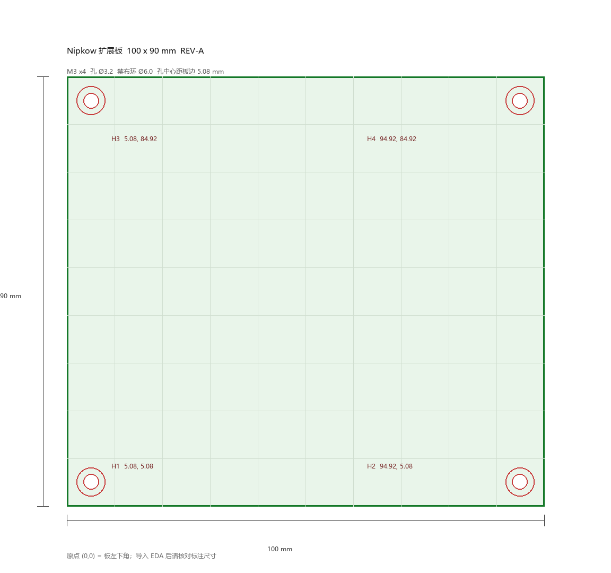

# PCB 下单前 P0 作业手册（板框 / 安装孔 / 装配核对）

> 适用工程：`扩展板1.eprj2`（嘉立创 EDA 专业版）
> 现状：59 个封装已按分区摆放，包围盒重叠 0；**板框、安装孔、布线、DRC 均未做**
> 本文对应 `TASKS.md` §3 P0 的第 1–3 项，读完可以直接照着点。
> 生成物：`docs/mech/board_100x90.dxf`、`docs/mech/board_99x89.dxf`、预览图、`.tools/make_board_dxf.py`

---

## 0. 开工前先解决两个内部矛盾

这两处不澄清，画完板框还会返工。

| # | 矛盾 | 事实 | 处理 |
|---|---|---|---|
| 1 | 板框到底多大 | `TASKS.md` §3 P0 写 **100×90**，但 §0 与 §5 风险表写器件是"**按 110×90 假设摆放**" | **以 100×90 为准**（赛题与下单限制），把 110 的假设当成"摆放时给的余量"，见 §4 |
| 2 | "单边 < 100 mm" | 100×90 的 100 边正好等于 100，不是"小于" | 若下单平台/优惠规则要求严格小于 100，用备用的 **99×89**（DXF 已一并生成，坐标表见 §4.3） |

> 结论：先按 100×90 落地；只有在嘉立创下单页明确报"尺寸超限"时才切 99×89。两者孔位到板边距离都是 5.08，切换只影响两个远端的孔坐标，不需要重新摆放器件。

---

## 1. 板框与安装孔规格（唯一数据源）

坐标原点取**板框左下角** `(0,0)`，单位 mm，Y 轴向上（EDA 与 DXF 一致）。

### 1.1 板框

| 项 | 值 | 换算 |
|---|---|---|
| 宽 W | **100.00 mm** | 3937 mil |
| 高 H | **90.00 mm** | 3543 mil |
| 形状 | 矩形，直角（不做圆角） | 圆角会压缩四角孔到板边距离，且拼板时无收益 |
| 板框层 | `Board Outline`（板框层） | 必须**闭合**，宽度 0 |

> 直角是有意选择：孔中心距边 5.08，孔径 3.2，孔边到板边还有 3.48 mm；加 R2 圆角后该值降到约 2.9 mm，没必要。

### 1.2 安装孔（4×M3）

| 编号 | X (mm) | Y (mm) | X (mil) | Y (mil) | 孔径 | 禁布环 Ø | 金属化 |
|---|---|---|---|---|---|---|---|
| H1 | 5.08 | 5.08 | 200 | 200 | 3.2 | 6.0 | **否**（NPTH） |
| H2 | 94.92 | 5.08 | 3737 | 200 | 3.2 | 6.0 | 否 |
| H3 | 5.08 | 84.92 | 200 | 3343 | 3.2 | 6.0 | 否 |
| H4 | 94.92 | 84.92 | 3737 | 3343 | 3.2 | 6.0 | 否 |

- **孔径 3.2**：M3 螺钉过孔标准值（M3 螺纹外径 2.95 ± 0.05，3.2 留 0.25 余量）。
- **NPTH（非金属化）**：孔壁不要铜。若做成金属化，拧紧时螺钉/铜柱会把 GND 与机壳短接，电机噪声直接灌进地平面。
- **禁布环 6.0**：孔中心 6 mm 内不放铜箔、走线、丝印文字，只允许丝印外框线。这个值对应 M3 平垫外径（约 6–7 mm）。
- 四角孔位对称，便于板子翻面安装、也方便"转 180° 装"时孔位仍然对得上。

### 1.3 与机械件的配合（第二阶段会用到）

- 若用 M3 铜柱 + 亚克力/3D 打印底座：孔位已按 100×90 的 4 角标准排布，**底座孔位直接抄 §1.2 的坐标**。
- 若底座尺寸未定：先按本表打孔，底座侧用长圆孔（腰形孔 ±1 mm）吸收公差，比反过来改板便宜。

---

## 2. 落地方式 A：导入 DXF（推荐）

DXF 已经把板框、4 个孔、禁布环、尺寸线全部画好，导入后只需要"认层 + 转板框"，比手工放 4 个孔少出错。

> 预览由 `.tools/make_board_dxf.py` 生成；改了尺寸/孔位后重跑脚本即可（见 `docs/MANIFEST.md` §3）。

### 2.1 步骤

1. 打开工程的 PCB 文档，切到 PCB 编辑界面。
2. 菜单 **文件 → 导入 → DXF**（若版本菜单不同，找"导入 → DXF/导入外部文件"）。
3. 选择 `docs/mech/board_100x90.dxf`，单位选 **mm**。
4. 导入位置填 `X=0, Y=0`（DXF 内部已带坐标，导入偏移必须为 0，否则整体平移）。
5. 图层映射按下面这张表核对：

| DXF 图层 | 导入到 | 说明 |
|---|---|---|
| `BOARD_OUTLINE` | 板框层（Board Outline） | 导入后若变成普通线条，选中 → 右键/菜单"转换为板框" |
| `MOUNTING_HOLE` | 多层（Multi-Layer）+ 孔 | 圆形线条需转成焊盘孔，见 §2.2 |
| `KEEPOUT` | 禁布区 / 铜箔禁止区 | 可选；也可以在 DRC 规则里用"孔到铜间距"代替 |
| `REF` | 任意机械层/丝印层 | 纯参考，导入后**整层删除**，出图前务必删干净 |

6. 导入完成后立刻做 §5 的核对。

### 2.2 把 DXF 的圆变成真正的安装孔

DXF 里的圆只是线条，不会产生钻孔。两种做法，任选：

- **做法 1（推荐，可控）**：删掉 `MOUNTING_HOLE` 层的 4 个圆，改用 **放置 → 焊盘**，逐个放通孔焊盘：
  - 形状：圆形；**孔径 3.2**；焊盘直径 **3.2**（焊盘 = 孔径即"无环"，配合"非金属化"就是纯钻孔）；
  - 属性里取消勾选**金属化 / Plated**；网络留空；
  - 坐标按 §1.2 表格填（属性面板直接输 X/Y，比鼠标放准）。
- **做法 2（快）**：保留圆，用"放置 → 挖槽区域 / 钻孔"逐个转换；或使用常用库里的"Mounting Hole Ø3.2"封装放置 4 个。

> 判定标准只有一个：**生成 Gerber/钻孔文件后，钻孔表里必须出现 4 个 Ø3.2 的孔**。只画了圆没有钻孔，打回来就是实心板。

---

## 3. 落地方式 B：手工输入（不导入 DXF 时）

1. **板框**：菜单 **设计 → 板子形状**，选矩形，宽 **100**、高 **90**（单位切 mm：`视图 → 单位`）。
   - 或者 **放置 → 边框/板框**，在板框层画 4 条线，属性里逐条改坐标 (0,0)-(100,0)-(100,90)-(0,90)；必须首尾相接闭合。
2. **安装孔**：**放置 → 焊盘** → 通孔，按 §1.2 表格填 4 组坐标，孔径 3.2，非金属化。
3. **核对**：用 **工具 → 测量距离** 拉一次 100.00 / 90.00，以及孔中心到板边的 5.08。

---

## 4. 110×90 → 100×90 的收缩策略

摆放时按 110 宽做的，现在要少 10 mm。**不要整体缩放**（位号、封装全乱），按下面的优先级"抽"出 10 mm：

### 4.1 先看越界多少

1. 画完板框后，框选全部器件，看包围盒右边界 X 最大值。
2. 若 `Xmax ≤ 100`：说明摆放时留了余量，**什么都不用动**，直接进 §6。
3. 若 `Xmax > 100`：超出量 `Δ = Xmax - 100`，按 §4.2 处理。

### 4.2 收缩顺序（从上到下依次尝试）

| 顺序 | 区域 | 可压缩量 | 做法 |
|---|---|---|---|
| 1 | 测试点 TP1–TP9 | 5–8 mm | 测试点可挪到板边或塞进空档，本来就是"顺手能戳到"即可 |
| 2 | 电源区（C1–C8、U2、U3、D1、R10/R11/R16） | 3–5 mm | 电容排间距 2.54 已够，别留 4 mm 空位；U3 散热敷铜保留 |
| 3 | 红外区（J4、J5、D2、R12/R13/R14） | 2–3 mm | 发射/接收管之间有机械间距要求时**不能压**，只能平移 |
| 4 | 串口/按键区（J7、KEY1/KEY2） | 2–5 mm | 端子可贴边放 |
| 5 | RGB 区（Q4–Q6、R17–R22、R3/R6/R9、J3） | 1–2 mm | 驱动三路对称，别破坏对称性 |

**不要动的**：U1 核心板 + 两组 2×20 排母的间距（固定 2.54×行距）、J6 电机端子（要插拔空间）、J1 电源端子。

### 4.3 99×89 备选方案的坐标

| 编号 | X (mm) | Y (mm) |
|---|---|---|
| H1 | 5.08 | 5.08 |
| H2 | **93.92** | 5.08 |
| H3 | 5.08 | **83.92** |
| H4 | **93.92** | **83.92** |

切 99×89 时右侧/上侧各让出 1 mm，器件区不受影响；只需保证没有器件摆到 X>99 或 Y>89。

---

## 5. 导入后必做的 6 项核对

画完不等于对，这 6 项每次改板框都过一遍：

1. **尺寸**：工具 → 测量距离，量 W=100.00、H=90.00（不是 99.9、不是 100.2）。
2. **闭合**：板框必须首尾相连；DRC 若报"板框未闭合"，先修这个，否则铺铜会溢出。
3. **孔位**：4 个孔中心到最近板边 = 5.08；孔与孔的 X/Y 差值 = 89.84 / 79.84。
4. **越界**：DRC 检查是否有"器件在板框外/超出板框"；逐个拖回（先看 §4.2 顺序）。
5. **孔旁禁布**：4 个孔中心 6 mm 内无走线、无过孔、无器件；尤其 H1/H2 附近容易压到电源区。
6. **原点**：把画布原点放在左下角（放置 → 画布原点），后续坐标文件、Gerber 对位都靠它。

---

## 6. 核心板方向核对（最容易翻车的一步）

排母一插错方向，PA9/PA10、5V 注入、板载 FLASH 全部对不上，而且不会报错——只会"程序烧不进去"或"一上电就发热"。

### 6.1 核对顺序

1. **打印 1:1 图**：PCB 导出 PDF（`导出 → PDF`），按 100% 打印，把真实核心板放上去比。
2. **对齐 1 脚**：核心板上 1 脚有丝印圆点/方焊盘；PCB 上 U1 的 1 脚焊盘必须是**方形**并加丝印 `1`。
3. **四角留出**：USB 口、SWD 调试口、复位键、BOOT 跳线必须朝向板外或上方，**不能被排母、端子、电容挡住**。
4. **关键脚位复核**（TASKS 已纠正过一次，务必再确认）：
   - 排针 **40 脚 = `PIN_IN_+5V`**
   - 排针 **38 脚 = `+3V3`**
   - `PA9/PA10`（USART1）**只在调试口**，不在 2×20 排针上 → 若要做调试串口，走 J7 或核心板调试口
5. **JP1 位置**：5V 从排针 PIN_IN_+5V 注入，JP1 应靠近排母 40 脚一侧，且跳线帽拔插不碰相邻器件。
6. **确认方法**：把核心板插上排母（不焊，压住即可），装到板上目视 + 卡尺量 USB 口到板边距离；确认后再焊。

### 6.2 需要旋转 U1 时

- 旋转 180° 会同时翻转 R15（PA4 CS 上拉）与 PA6/PA7 出线方向，**旋转后必须重跑一次网表**（见 `TASKS.md` §2.2 的 4 轮网表验证流程）。
- 旋转 U1 后，所有连到排母的网络飞线会重新排布，**先别布线，等方向定死再布**。

---

## 7. 布线前的规则设置

详细线宽/间距/关键网络路径见 `docs/ROUTING.md`。这一步只列"必须在自动布线前设好"的：

1. **设计 → 设计规则**：默认线宽 0.25、最小间距 0.2、过孔 0.3/0.6。
2. **设计 → 网络类管理器**：建 `PWR`（VIN、5V、3V3、GND）、`MOTOR`（VIN、电机 PWM/FG）、`SIG`（其余）三类，分别套线宽。
3. **铺铜**：先铺 GND（底层整片 + 顶层补铜），再布线——顺序反了会反复重铺。
4. **自动布线**：只对 `SIG` 类跑；`PWR`/`MOTOR` 手工布（自动布线器不会给你 1.2 mm 的电机线）。

---

## 8. 收尾与下单

### 8.1 收尾顺序（不要跳）

1. 自动布线 → 检查残留飞线（`视图 → 飞线`），逐条手工补。
2. 加宽电源/电机走线（见 `ROUTING.md` 表格）。
3. 铺铜重算，检查孤岛（`工具 → 铺铜管理器`）。
4. DRC 0 错误；警告逐条处理或加"忽略"并记录原因。
5. 3D 预览：U3 散热片高度、排母插拔空间、端子出线方向、核心板 USB 口。
6. 丝印：接口名（J1–J7）、极性（D1/LED/电解电容）、版本号 `REV-A 2510`、J7 定义（`1 GND 2 TX 3 RX 4 3V3(默认不贴)`）。
7. 加 4 个光学定位点（Mark 点，Ø1.0 铜 + Ø2.0 阻焊开窗），SMT 贴片要用。

### 8.2 下单参数建议

| 项 | 值 | 理由 |
|---|---|---|
| 尺寸 | 100 × 90 mm | §1 |
| 层数 | 2 层 | 够用，便宜 |
| 板厚 | 1.6 mm | 标准 |
| 铜厚 | 1 oz | 标准；5V 0.3 A、电机 2 A 级够 |
| 阻焊 | 绿色（或其他） | 无影响 |
| 表面处理 | **沉金 ENIG** | 0603 + 0.2 mm 间距，喷锡易连锡；沉金平整 |
| 最小线宽/间距 | 6/6 mil | 与 §7 规则一致 |
| 过孔 | 0.3/0.6 mm | 标准工艺 |
| 工艺边 | 5 mm（拼板时） | 若单板下单则不需要 |
| 半孔/阻抗 | 无 | — |

> 下单前把 `TASKS.md` §3 的 P0 清单逐条打勾，缺一条就先别付款。

---

## 9. 一页版验收清单

复制到手机/打印出来，做完一项划一项：

- [ ] 板框 100.00 × 90.00，闭合，直角
- [ ] 4 × Ø3.2 NPTH，坐标 (5.08,5.08) (94.92,5.08) (5.08,84.92) (94.92,84.92)
- [ ] 孔中心 6 mm 内无铜无走线
- [ ] 钻孔表里能看到 4 个 Ø3.2
- [ ] 无器件越界（DRC 报 0）
- [ ] U1 方向核对：1 脚方焊盘、USB/SWD 朝外、40 脚 = 5V、38 脚 = 3V3
- [ ] JP1 拔插不干涉
- [ ] 电源/电机线宽达标（见 ROUTING.md）
- [ ] GND 铺铜完整，无孤岛
- [ ] DRC 0 错误
- [ ] 3D 预览无干涉
- [ ] 丝印齐全（接口名/极性/版本/J7 定义）
- [ ] 4 个 Mark 点
- [ ] Gerber + 钻孔 + BOM + 坐标文件已导出并解压检查

---

## 10. 变更记录

| 日期 | 内容 |
|---|---|
| 2026-10-25 | 首版：板框/孔坐标定稿，DXF 生成器上线，110→100 收缩策略 |
